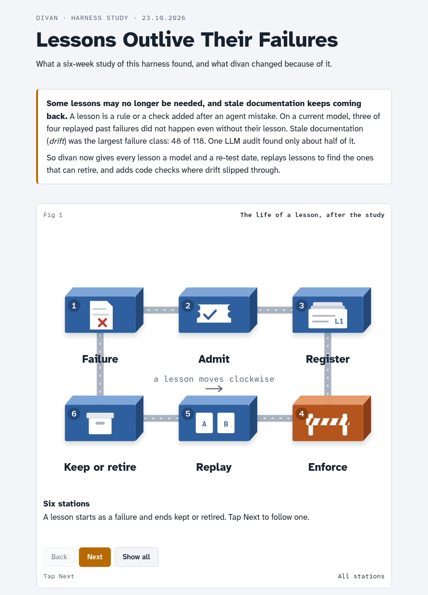
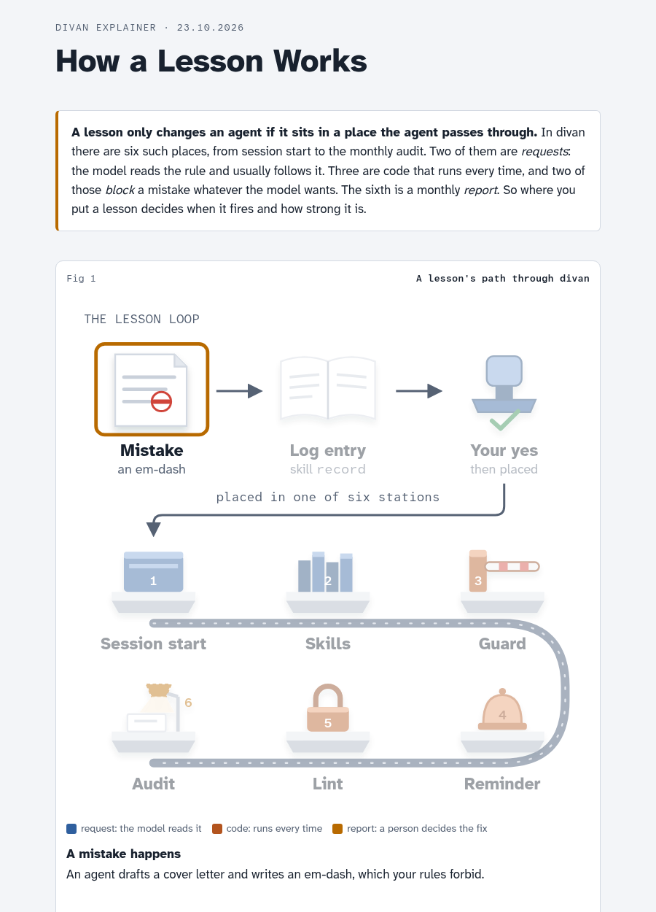
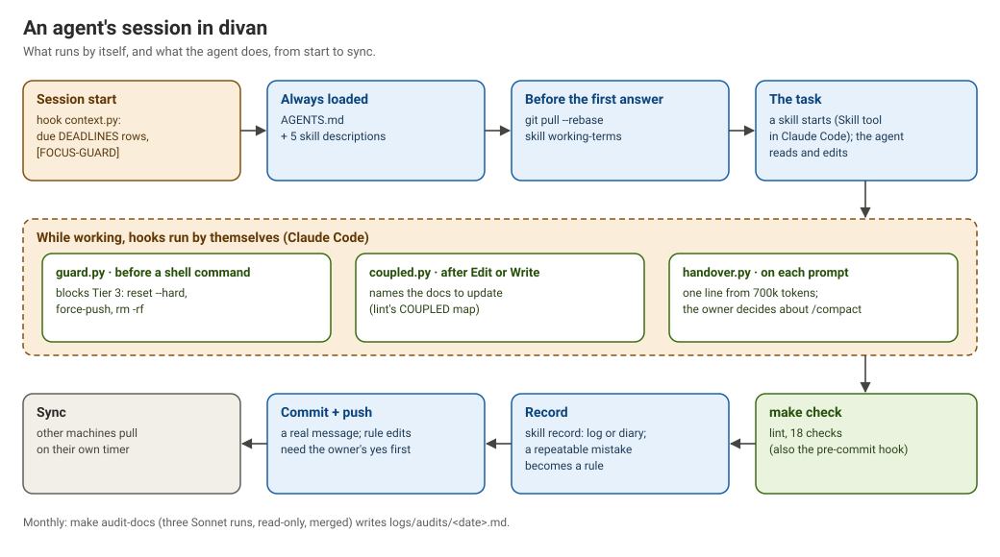

<p align="center"></p>

# divan

A personal system of record that AI coding agents can work in safely. Plain markdown in git, a set of rules every agent loads, and hooks and a lint that hold when the agent does not read the rules.

divan grew out of one person's job search, language study and life admin, run with Claude Code, Antigravity and Hermes on a laptop and a small server. This repo is its **governance layer**: the part that is not about that person. Release 0 holds the hooks, the lint, the git sync and five skills. You bring the content.

## Lessons outlive their failures

divan was the subject of a six-week study of its own harness: 118 agent failures, a test of how much stale documentation an LLM audit finds, and a replay of past failures with and without their fixes. Two results changed divan. On a current model, three of four replayed failures did not happen even without their fix, so lessons can outlive the failures they were written for. Stale documentation was the largest failure class (48 of 118), and one audit run found only about half of it. divan now records every lesson with its model and a re-test date (`logs/lessons.csv`), replays lessons to find the ones that can retire (`make replay`), and adds code checks where drift slipped through.

The page: [Lessons Outlive Their Failures](https://avtak.github.io/divan/lessons-outlive-their-failures.html). The paper: *Lessons Outlive Their Failures: A Case Study of Rules for AI Coding Agents*, preprint, arXiv cs.SE, October 2026. The full citation and the arXiv link follow once the preprint is announced.

## Pages and diagrams

The pages open in the browser at [avtak.github.io/divan](https://avtak.github.io/divan/). Their source is in `docs/`.

| [Lessons Outlive Their Failures](https://avtak.github.io/divan/lessons-outlive-their-failures.html) | [How a Lesson Works](https://avtak.github.io/divan/how-a-lesson-works.html) |
|---|---|
| [](https://avtak.github.io/divan/lessons-outlive-their-failures.html) | [](https://avtak.github.io/divan/how-a-lesson-works.html) |
| What the study found, and what divan changed | The six places where a lesson can sit, and how strong each one is |

**An agent's session:** what runs by itself, and what the agent does, from start to sync.



**How context loads:** what every session loads, and what loads only when needed.


**Which file wins:** when two files disagree, the higher one wins, and an AI's inference never outranks a file.


## Canon beats impressions

An agent's memory store is an impression: a summary of what it thinks it saw. A file in git is canon: dated, diffable, and the same for every agent and every model. divan keeps every fact in exactly one file and ranks the files (`AGENTS.md` "Which file wins"). Agent memory never outranks a file, so `.claude/settings.json` turns Claude Code's automatic memory off.

## The layers

| Layer | What | Why it is there |
|---|---|---|
| Rules | `AGENTS.md`, nested `scripts/AGENTS.md` | Every runtime loads `AGENTS.md`. It stays short: about 5,000 characters |
| Skills | `skills/<name>/SKILL.md` | A workflow loads only when it triggers. Design rules: `skills/README.md` |
| Hooks | `scripts/hooks/` | What must happen even when the prose is not read |
| Lint | `scripts/lint.py`, run by `scripts/hooks/pre-commit` | What must never reach a commit |
| Sync | `scripts/divan-sync`, `scripts/divan-watch` | Git is the only sync between machines |
| Records | `logs/`, `diary/` | What changed and why. What happened and how it went |
| Lessons | `logs/lessons.csv`, `scripts/replay.py` | Each lesson's model and re-test date, and a replay that shows when it can retire |

### The five skills

| Skill | Fires |
|---|---|
| `working-terms` | At session start: answer first, plain English, honest odds, the owner's time before a task, a stop at 15 minutes |
| `record` | At session end: a change goes in an area log, a human episode in the diary. Never tidy a diary entry, never invent a feeling |
| `focus-guard` | When a deadline is close and the owner reaches for a new tool instead |
| `repo-sync` | When a sync stops: what each `ABORT` line means and the fix |
| `delegate` | Before a search or audit: how to brief a subagent and check its report |

### The hooks

| Hook | Event | What it does |
|---|---|---|
| `context.py` | Session start | Puts overdue and this-week rows of `DEADLINES.md` in front of the agent, and raises `[FOCUS-GUARD]` when a deadline is 7 days away or less |
| `guard.py` | Before a shell command | Refuses `git reset --hard`, force-push, `rm -rf` outside a temp folder, `git clean -f`, history rewrites and server-user or firewall changes over SSH. It reads shell words, so `git -C <dir> reset --hard` is caught and a quoted mention is not. One script serves three runtimes. `--probe` runs its test cases |
| `coupled.py` | After an edit (Claude Code) | Names the docs that describe the file just edited, from the lint's COUPLED map |
| `handover.py` | Each prompt | One line when the session passes a set size. The owner decides what to do |
| `pre-commit` | Each commit | Runs the lint |
| `commit-msg` | Each commit | Refuses a secret or an identifier in the commit message |

## What the lint refuses

`scripts/lint.py` is stdlib Python. The full list is in its docstring. The ones worth knowing:

- **A deadline date in two places.** A date in `DEADLINES.md` must not appear in any other live file. A copy goes stale the day the date moves.
- **A dead pointer.** A backticked repo path that does not exist.
- **A skill the docs do not list,** or a wrong count of skills in prose.
- **A script `README.md` never names.** No tool arrives unannounced.
- **A prompt-injection pattern** in `AGENTS.md` or a `SKILL.md`, with the same regexes Hermes uses to block a file.
- **A `CLAUDE.md`.** With one present, Claude Code stops reading `AGENTS.md`.
- **A staged secret, identifier or `.env` file.** Identifiers are IBANs (with their checksum), case, customer, contract or passport numbers after their label, and phone numbers outside `ABOUT_ME.md`. `python3 scripts/lint.py --scan-ids` sweeps the whole repo once.
- **A pointer to a heading that left its file:** a backticked file name followed by a quoted heading that the file no longer has.
- **Warnings, not refusals:** a file changed while the docs that describe it did not (the COUPLED map), a status "as of" a date older than 14 days, a log entry over 800 characters, all rule text over its word budget, and a lesson in `logs/lessons.csv` whose anchor left its file or whose re-test is due.

## Install in 3 commands

Needs git, bash and python3 (3.10 or newer). Linux is tested. The sync uses `flock` and `/proc`.

```bash
git clone https://github.com/avtak/divan my-divan && cd my-divan
./setup.sh            # hooks path, skill links, lint
./setup.sh --sync     # optional: the laptop sync timer, after you add your own private remote
```

Then open `START_HERE.md`. **Keep your copy private.** It will hold your life.

## The daily loop

1. The agent starts. The context hook shows what is due. The agent reads `skills/working-terms/SKILL.md`.
2. You work. The guard refuses the dangerous commands. After each edit, Claude Code hears which docs to check.
3. The agent finishes: `make check`, a log or diary entry (skill `record`), a commit, a push.
4. The laptop timer syncs what you edited by hand, after 10 quiet minutes. It holds rule files until you commit them yourself.

`make help` lists the commands: `make check`, `make sync`, `make sanitise`, `make audit-docs`, `make replay`.

## Portability

| Part | Claude Code | Antigravity | Hermes | Any git user |
|---|---|---|---|---|
| `AGENTS.md`, `skills/` | yes | yes | yes | read by hand |
| `guard.py` | yes | yes | yes | |
| `context.py` | yes | yes | yes | |
| `handover.py` | yes | yes | | |
| `coupled.py` | yes | | | |
| Lint and `pre-commit` | yes | yes | yes | yes |
| `divan-sync` | yes | yes | yes | yes (Linux) |
| Worktree cleanup in the sync | yes | | | |

Claude Code reads `.claude/settings.json`. Antigravity reads `.agents/hooks.json`. Hermes needs two blocks in its own `config.yaml` (replace `/path/to/divan`):

```yaml
skills:
  external_dirs:
    - /path/to/divan/skills
hooks:
  pre_tool_call:
    - matcher: "terminal"
      command: "python3 /path/to/divan/scripts/hooks/guard.py"
      timeout: 5
      fail_closed: true
  pre_llm_call:
    - command: "python3 /path/to/divan/scripts/hooks/context.py --hermes"
      timeout: 25
```

Hermes also needs `shell-hooks-allowlist.json` in its home folder with the same two command strings. Without it, Hermes skips the hooks silently. Check with `hermes hooks doctor`.

## All scripts

| Script | What |
|---|---|
| `scripts/lint.py` | The checks. `--probe` self-tests checks 1 and 8. `--scan-ids` sweeps every tracked file for identifiers |
| `scripts/audit_docs.sh` | The monthly read-only doc audit: three Sonnet runs, merged (`make audit-docs`) |
| `scripts/replay.py` | Replays a past failure with and without its lesson, to find lessons that can retire (`make replay`). Scenarios go in a `scenarios.json` next to it |
| `scripts/sanitise.py` | Finds personal data before a public commit: your terms from a file outside the repo, plus e-mails, phones, IPs, home paths, tailnet names, SSH aliases |
| `scripts/divan-sync` | Pull, commit, push. Timid by design |
| `scripts/divan-watch` | Runs `divan-sync` when files settle (server) |
| `scripts/plain_check.py` | Plain-English check: the patterns skill `working-terms` §1a forbids |
| `scripts/hooks/context.py`, `guard.py`, `coupled.py`, `handover.py`, `pre-commit`, `commit-msg` | The hooks above |
| `scripts/systemd/` | User units for the laptop timer and the server watcher |

## Roadmap

- **Release 1:** a deadline and status board, a standup message, a JSON application store with one command to record an application, and the job-search skills as templates.
- **Release 2:** an example lead pipeline, and a guide to running Hermes on a server.

## Licence and credits

MIT for everything here (`LICENSE`). Lint check 4 copies its regexes from NousResearch/hermes-agent (MIT). The notice: `THIRD_PARTY_NOTICES.md`.

The plain-English rules in skill `working-terms` paraphrase the sentence rules of ASD-STE100 in their own words. The repo reproduces no text from the specification or its dictionary. divan is an unofficial project, not affiliated with or endorsed by ASD or STEMG. ASD-STE100 is a registered trademark of ASD.
