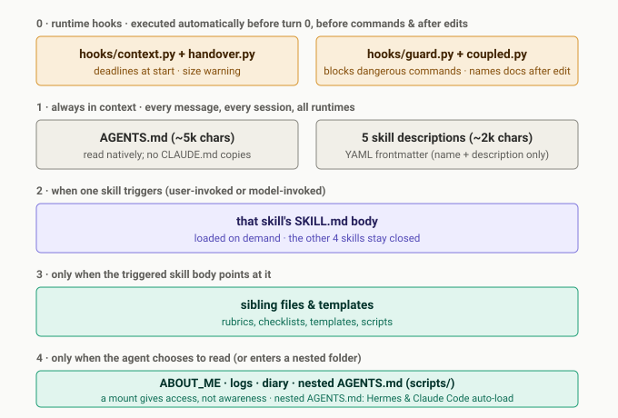
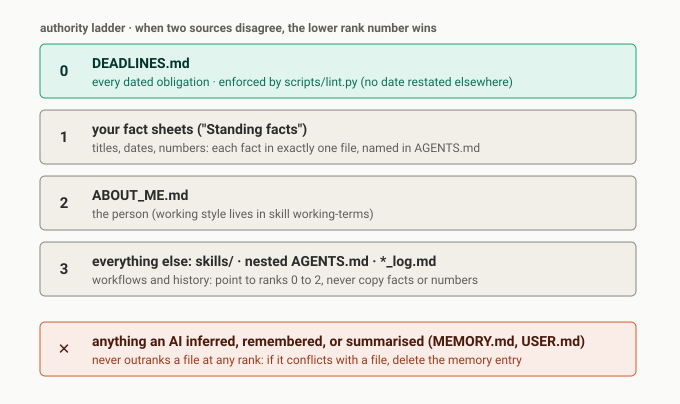

# How `skills/` works

Design rules for this folder. Read this before writing, editing, or reviewing a skill.

---

## 1. Loading layers: why skills exist

An AI agent has one context window. Everything loaded into it competes for the same attention budget: the longer the standing prompt, the less reliably any single rule is followed. The repo splits instructions across five layers so each session only pays for what it needs:

| Layer | What lives there | When it loads | Cost |
|---|---|---|---|
| **0. Runtime hooks** | `scripts/hooks/context.py` (overdue and this-week deadlines, and the `[FOCUS-GUARD]` alert), `scripts/hooks/handover.py` (one warning when the session passes a set size), `scripts/hooks/guard.py` (blocks the commands `AGENTS.md` forbids) and `scripts/hooks/coupled.py` (Claude Code only: after an edit, names the docs to update) | Automatically on `SessionStart`, `UserPromptSubmit`, `PreToolUse` and `PostToolUse` | Paid once per session, per band or per tool call. Deterministic |
| **1. Always loaded** | Root `AGENTS.md` + the **name and `description:`** of every `skills/*/SKILL.md` | Every session, at start | Paid on every turn. Keep `AGENTS.md` short and every `description:` to one tight paragraph |
| **2. Skill body** | The rest of `skills/<name>/SKILL.md` | Only when the skill triggers | Zero in sessions that do not use it |
| **3. Skill siblings** | Rubrics, templates and `evals/` inside a skill folder | Only when a step in `SKILL.md` says *read this now* | Zero until that step runs |
| **4. On demand** | `ABOUT_ME.md`, the logs, the area rules (nested `AGENTS.md`) | When the agent reads them; Claude Code loads an area `AGENTS.md` when it reads a file in that folder | Zero outside that work |

**Rule 1: put workflow procedures in a skill, not in `AGENTS.md`.** If a rule only matters for one kind of work, it belongs in `skills/<name>/SKILL.md` (Layer 2), not in `AGENTS.md` (Layer 1).

**Rule 2: runtime discovery uses repo-local links only.** `setup.sh` creates them.
- Claude Code reads `.claude/skills/`, a symlink to `../skills`
- Antigravity reads `.agents/skills/`, a symlink to `../skills`
- Hermes reads `skills/` through `skills.external_dirs` in its config

Never create a symlink from `~/.claude` or `~/.gemini` into this repository (`scripts/lint.py` check 7 enforces this).

**Rule 3: Hermes scans `skills/` for prompt-injection patterns.** Hermes scans every `SKILL.md` before loading it and blocks the whole file on a hit. `scripts/lint.py` check 4 runs the same regexes on every commit. Never include literal examples of reading credential files or bypassing system instructions inside `skills/`.

---

## 2. Authority: which file wins

Skills are **workflows**, not sources of truth. Precedence follows the ranks in [`AGENTS.md`](../AGENTS.md#which-file-wins).

**Rule 4: a skill never copies a fact; it points to the owner file.** `scripts/lint.py` fails the commit if a date owned by `DEADLINES.md` is restated anywhere else, or if a `SKILL.md` references a file path that does not exist.

---

## 3. Logic, facts, meaning: the three-way split

Keeping a skill clean means keeping three things in three different places:

| Question | Where it lives | Example |
|---|---|---|
| **How do I do the task?** *(steps, gates, commands, order)* | `skills/<name>/SKILL.md` | *"Score the fit, stop and wait for the owner's approval before building."* |
| **What are the raw facts?** *(dates, titles, numbers)* | A fact sheet, rank 1 | *"Degree, grade, year."* |
| **What does a piece of work prove, and how do we phrase it?** | A claims file next to the fact sheet | *"The thesis proves pipeline engineering; never sell it by the mark."* |

When a fact changes, you edit the fact sheet once. Every skill that points at it stays current without being touched.

---

## 4. Conventions

1. **Frontmatter `description:` carries the trigger words.** Write both what the skill does and the exact phrases or situations that should fire it. Keep frontmatter to `name` and `description` so it works the same in Claude Code, Antigravity and Hermes.
2. **User-invoked or model-invoked (every skill is one of the two):**
   - **User-invoked:** `repo-sync`. It waits until the owner asks. A user-invoked skill that produces something has a hard gate where the agent shows a plan and waits for approval.
   - **Model-invoked:** `working-terms`, `record`, `focus-guard`, `delegate`. They fire on their condition: `working-terms` at session start, `record` at session end, `focus-guard` on distraction or the deadline alert, `delegate` on multi-file research or audits.
3. **Move static payloads and test suites into sibling files.** Keep `SKILL.md` to the decision tree and steps (Layer 2). Put evaluation suites or static assets (like `skills/<name>/evals/evals.json`) in sibling files (Layer 3), so they load only when needed.
4. **Every line must change a decision.** Cut explanations a model already knows. Keep hard constraints, exact repo commands, file pointers, and non-obvious failure modes.
5. **All paths are relative to the repository root.** Write `logs/system_log.md`, never an absolute path or `../logs/system_log.md`.

---

## 5. Checklist for reviewing a skill

1. **Trigger:** would the one-paragraph `description:` alone tell an agent *when* to load this skill and *when not to*?
2. **Duplication:** does the body repeat any date from `DEADLINES.md`, any number from a fact sheet, or any rule already in root `AGENTS.md`? Delete the copy and leave a pointer.
3. **Layering:** is a large template, rubric, or example block sitting inline in `SKILL.md` that only one step needs? Move it to a sibling file.
4. **Gates:** is it clear where the agent must **stop and ask the owner**, and where it has standing permission to act?
5. **Verification:** does `python3 scripts/lint.py` pass? It checks every file path mentioned in `skills/` and runs the prompt-injection scan.
6. **Freshness:** did a tool, script, or workflow change without the skill being updated? Compare against the newest entries in the area log.
